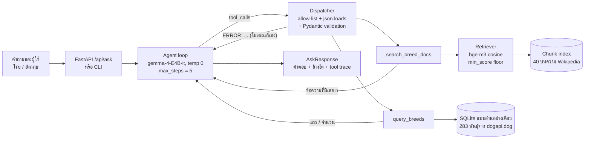

<div align="center">

# 🐕 Dog Breed Advisor

**ผู้ช่วย AI สำหรับคนที่จะเลี้ยงสุนัขครั้งแรก ช่วยเลือกและเรียนรู้สายพันธุ์สุนัข ถามได้ทั้งภาษาไทยและภาษาอังกฤษ**

agent จะตัดสินใจเองว่าคำถามแต่ละข้อต้องค้นจากบทความ (RAG พร้อมอ้างอิง) หรือจากฐานข้อมูล (SQL แบบปลอดภัย) ตอบจากข้อมูลที่ค้นเจอเท่านั้น และตอบว่า *"ไม่พบข้อมูล"* แทนการเดา


[จุดเด่น](#-จุดเด่น) · [ถามอะไรได้บ้าง](#-ขอบเขตคำถาม-ถามอะไรได้บ้าง) · [การทำงาน](#-ระบบทำงานอย่างไร) · [วิธีติดตั้ง](#-วิธีติดตั้งและรัน) · [ผลการประเมิน](#-ผลการประเมิน) · [ความปลอดภัย](#️-ความปลอดภัย) · [ข้อจำกัด](#️-ข้อจำกัด)

</div>

---

## ✨ จุดเด่น

| | |
|---|---|
| 🔀 **agent เลือกเครื่องมือเอง** | คำถามเชิงบรรยายใช้ `search_breed_docs` คำถามตัวเลขใช้ `query_breeds` คำถามผสมใช้ทั้งสองแบบ |
| 📚 **ตอบพร้อมแหล่งอ้างอิง** | ข้อมูลจากบทความทุกข้อมีเลข `[n]` ที่ลิงก์กลับไปหน้า Wikipedia ต้นฉบับ |
| 🇹🇭 **ไทยและอังกฤษ** | `bge-m3` เป็นโมเดลหลายภาษา ถามเป็นไทยก็ค้นบทความภาษาอังกฤษเจอ (BM25 หาไม่เจอเลย) |
| 🛡️ **ปลอดภัยตั้งแต่การออกแบบ** | โมเดลไม่ได้เขียน SQL เอง argument ของทุก tool ผ่านการตรวจด้วย Pydantic และฐานข้อมูลเปิดแบบอ่านอย่างเดียว |
| 📏 **ตัดสินใจจากตัวเลข ไม่ใช่การเดา** | `min_score`, ขนาด chunk และวิธีค้น เลือกจากผลการประเมิน แล้วตรวจซ้ำด้วย held-out set |

---

## 💬 ขอบเขตคำถาม: ถามอะไรได้บ้าง

### ✅ แบบที่ 1 คำถามเชิงบรรยาย (ค้นจากบทความ Wikipedia)

ถามเรื่อง **นิสัย, ประวัติ, ต้นกำเนิด, การดูแล, สุขภาพ, ขน, การออกกำลังกาย** ได้เฉพาะ **40 สายพันธุ์** ต่อไปนี้

| | | | |
|---|---|---|---|
| Labrador Retriever (ลาบราดอร์) | Golden Retriever (โกลเด้น) | German Shepherd (เยอรมันเชพเพิร์ด) | French Bulldog (เฟรนช์บูลด็อก) |
| Bulldog (บูลด็อก) | Poodle (พุดเดิ้ล) | Beagle (บีเกิ้ล) | Rottweiler (ร็อตไวเลอร์) |
| Dachshund (ดัชชุนด์) | Pembroke Welsh Corgi (คอร์กี้) | Siberian Husky (ไซบีเรียนฮัสกี้) | Shih Tzu (ชิสุ) |
| Pomeranian (ปอมเมอเรเนียน) | Chihuahua (ชิวาวา) | Pug (ปั๊ก) | Boxer (บ็อกเซอร์) |
| Great Dane (เกรทเดน) | Dobermann (โดเบอร์แมน) | Border Collie (บอร์เดอร์คอลลี่) | Shiba Inu (ชิบะอินุ) |
| Akita (อาคิตะ) | Bernese Mountain Dog (เบอร์นีส) | Cavalier King Charles Spaniel (คาวาเลียร์) | Yorkshire Terrier (ยอร์คเชียร์) |
| Maltese (มอลทีส) | Bichon Frise (บิชอง) | Basenji (บาเซนจิ) | Dalmatian (ดัลเมเชียน) |
| Saint Bernard (เซนต์เบอร์นาร์ด) | Greyhound (เกรย์ฮาวด์) | Australian Shepherd (ออสเตรเลียนเชพเพิร์ด) | Shetland Sheepdog (เชตแลนด์) |
| Bull Terrier (บูลเทอร์เรีย) | Jack Russell Terrier (แจ็ครัสเซลล์) | Samoyed (ซามอยด์) | Alaskan Malamute (อะแลสกันมาลามิวท์) |
| Thai Ridgeback (ไทยหลังอาน) | Thai Bangkaew (บางแก้ว) | Chow Chow (เชาเชา) | Newfoundland (นิวฟันด์แลนด์) |

**ตัวอย่างคำถาม**
- ชิบะอินุมาจากประเทศอะไร
- ไซบีเรียนฮัสกี้ผลัดขนบ่อยแค่ไหน
- Golden Retriever เข้ากับเด็กเล็กได้ไหม
- What were Dachshunds originally bred to hunt?

### ✅ แบบที่ 2 คำถามตัวเลข (ค้นจากฐานข้อมูล)

ถามแบบ **เรียงลำดับ / นับจำนวน / กรอง** ได้ทั้ง **283 สายพันธุ์** จากข้อมูลเหล่านี้

| ข้อมูล | ตัวอย่างคำถาม |
|---|---|
| น้ำหนักเฉลี่ย (กิโลกรัม) | พันธุ์ไหนหนักที่สุด 3 อันดับ · พันธุ์ไหนหนักไม่เกิน 5 กิโล |
| อายุขัยเฉลี่ย (ปี) | พันธุ์ไหนอายุยืนที่สุด · มีกี่พันธุ์ที่อายุยืนเกิน 15 ปี |
| กลุ่มพันธุ์ (ตาม AKC) | มีกี่พันธุ์ใน Toy Group · พันธุ์ไหนใน Herding Group หนักที่สุด |
| hypoallergenic (ขนไม่ค่อยก่อภูมิแพ้) | พันธุ์ hypoallergenic ที่หนักไม่เกิน 10 กิโล |

กลุ่มพันธุ์ที่มีในฐานข้อมูล: `Herding Group` · `Hound Group` · `Non-Sporting Group` · `Sporting Group` · `Terrier Group` · `Toy Group` · `Working Group` · `Foundation Stock Service` · `Miscellaneous Class`

### ✅ แบบที่ 3 คำถามผสม (ใช้ทั้งสองแบบ)

- Beagle นิสัยเป็นยังไง และหนักกี่กิโล
- Pug มีปัญหาการหายใจเพราะอะไร และอายุขัยเฉลี่ยกี่ปี

### ❌ เรื่องที่ระบบไม่ได้ออกแบบมาให้ตอบ

| ประเภท | ตัวอย่าง | ระบบจะทำอะไร |
|---|---|---|
| การดูแลสุนัขทั่วไป | อาหารที่อันตราย, การฝึกขับถ่าย, ค่าวัคซีน | บอกว่าไม่มีข้อมูลในเอกสาร |
| นิสัยของพันธุ์ที่ไม่อยู่ใน 40 พันธุ์ | Shar Pei, Xoloitzcuintli | **อาจตอบไม่ตรง** เพราะยังเป็นเรื่องสุนัข ระบบจึงอาจดึงบทความพันธุ์อื่นมา |
| ส่วนสูง, ราคา, สถิติโลก | Labrador สูงเท่าไหร่ | ฐานข้อมูลไม่มีข้อมูลเหล่านี้ |
| เรื่องที่ไม่เกี่ยวกับสุนัข | เมืองหลวงของฝรั่งเศส | ปฏิเสธว่าตอบได้เฉพาะเรื่องสายพันธุ์สุนัข |

> ⚠️ **ไม่ใช่คำแนะนำทางสัตวแพทย์** เรื่องสุขภาพควรปรึกษาสัตวแพทย์เสมอ

---

## 🧠 ระบบทำงานอย่างไร



1. agent ส่งคำถามพร้อมรายการ tool 2 ตัวให้ `gemma-4-E4B-it` (temperature 0 เพื่อให้ผลเหมือนเดิมทุกครั้ง)
2. เมื่อโมเดลขอเรียก tool **dispatcher** จะตรวจว่าชื่อ tool อยู่ในรายการที่อนุญาต แปลง argument จาก JSON แล้วตรวจด้วย Pydantic ถ้าไม่ผ่าน จะส่ง `ERROR: ...` กลับไปให้โมเดลแก้เอง
3. ผลจาก tool ถูกห่อเป็น `TOOL RESULT (untrusted data) <<< … >>>` ก่อนส่งให้โมเดลอ่าน
4. loop จบเมื่อโมเดลตอบ, ครบ `max_steps` หรือเรียก tool ซ้ำเดิม แล้วบังคับให้ตอบโดยปิด tool

### กลุ่มความสามารถตามเกณฑ์รายวิชา

| # | หมวด | อยู่ที่ไหน |
|---|---|---|
| 1 | Structured output + schema validation | `app/schemas/` — Pydantic ตรวจ argument ของทุก tool ถ้าไม่ผ่านส่งกลับให้โมเดลแก้ |
| 2 | Retrieval / RAG พร้อมอ้างอิง | `app/retrieval/` — ตัดตามหัวข้อ (250 คำ ซ้อน 15%), bge-m3, cosine, `min_score` floor, อ้างอิง `[n]` |
| **3** | **Retrieval evaluation** | `evaluation/` — Recall@k / MRR เทียบ BM25, sweep ขนาด chunk และ `min_score`, ประเมิน agent เทียบแบบไม่มี tool ทั้งชุดที่ใช้ปรับระบบและ held-out set |
| **4** | **Agent loop with tools** | `app/services/agent.py` — native tool calling, allow-list, `max_steps`, ตรวจการเรียกซ้ำ, บังคับค้นก่อนตอบว่าไม่พบ |
| **5** | **Guarded SQL** | `app/tools/query_breeds.py` — อ่านอย่างเดียว, อนุญาตเฉพาะ SELECT, `?` parameter binding, คอลัมน์เรียงลำดับจาก allow-list |
| 6 | Served interface | `app/api/` — FastAPI + หน้าเว็บ, deploy บน Render |

---

## 🚀 วิธีติดตั้งและรัน

> ต้องมี [uv](https://docs.astral.sh/uv/) และสิทธิ์ใช้ LLM proxy ของรายวิชา

**1. ติดตั้งและตั้งค่า**

```bash
uv sync
cp .env.example .env        # Windows: copy .env.example .env
```

ใส่ค่าในไฟล์ `.env` (ไฟล์นี้อยู่ใน `.gitignore` ห้าม commit เด็ดขาด)

```
OPENAI_API_KEY=...
OPENAI_BASE_URL=...
```

**2. ทดสอบการเชื่อมต่อ** (แชท, embedding และ tool calling)

```bash
uv run python -m scripts.check_connection
```

**3. สร้างฐานข้อมูลและ index**

```bash
uv run python -m scripts.build_db        # สร้าง SQLite จาก data/raw/dogapi_breeds.json
uv run python -m scripts.build_index     # ตัด chunk + embed ด้วย bge-m3 (cache ไว้ใน data/cache/)
```

**4. รัน**

```bash
uv run python -m scripts.ask "Which 3 breeds are the heaviest?"     # ถามผ่าน terminal
uv run uvicorn app.api.main:app --reload                          # หน้าเว็บ → http://127.0.0.1:8000
```

<details>
<summary><b>ดาวน์โหลดข้อมูลดิบใหม่ (ไม่บังคับ)</b></summary>

ข้อมูลดิบอยู่ใน `data/raw/` แล้ว ถ้าต้องการดึงใหม่ ให้เพิ่ม `WIKI_CONTACT=<อีเมลหรือลิงก์ GitHub>` ใน `.env` ก่อน
เพราะนโยบาย User-Agent ของ Wikipedia กำหนดให้ต้องมีช่องทางติดต่อ ไม่อย่างนั้นจะโดนบล็อกด้วย HTTP 403 แล้วรัน

```bash
uv run python -m scripts.fetch_data      # บทความ Wikipedia 40 เรื่อง + ตารางจาก dogapi.dog
```
</details>

<details>
<summary><b>Deploy บน Render</b></summary>

| ช่อง | ค่า |
|---|---|
| Language | Python 3 |
| Build command | `uv sync --frozen && uv run python -m scripts.build_db && uv run python -m scripts.build_index` |
| Start command | `uv run uvicorn app.api.main:app --host 0.0.0.0 --port $PORT` |
| Environment | `OPENAI_API_KEY`, `OPENAI_BASE_URL` และ (ไม่บังคับ) `ACCESS_CODE`, `MAX_ASKS_PER_HOUR` (ค่าเริ่มต้น 60) |

ถ้าตั้ง `ACCESS_CODE` ต้องเปิดหน้าเว็บผ่าน `https://<app>.onrender.com/?code=<ACCESS_CODE>`
เพื่อไม่ให้ใครก็ได้ใช้คีย์ของ proxy แผนฟรีจะหลับหลังไม่มีคนใช้ 15 นาที และคำขอแรกหลังจากนั้นใช้เวลาประมาณ 1 นาที
</details>

---

## 📊 ผลการประเมิน

ตัวเลขทั้งหมดมาจาก `evaluation/results/` และรันซ้ำได้ด้วย temperature 0

```bash
uv run python -m evaluation.eval_retrieval                            # retrieval + sweep
uv run python -m evaluation.eval_agent                                # agent, ชุดที่ใช้ปรับระบบ
uv run python -m evaluation.eval_agent evaluation/heldout_set.jsonl   # agent, held-out set
uv run pytest                                                         # unit test 43 ข้อ (ไม่ต้องใช้คีย์)
```

### การค้นเอกสาร: dense ชนะ baseline BM25

คำถามที่มีเฉลย 32 ข้อ (อังกฤษ 22 / ไทย 10), chunk 250 คำ

| วิธีค้น | Recall@1 | Recall@5 | MRR@10 | Recall@5 อังกฤษ | Recall@5 ไทย |
|---|---:|---:|---:|---:|---:|
| BM25 (baseline) | 0.672 | 0.688 | 0.688 | 1.00 | **0.00** |
| **Dense bge-m3 (ที่ใช้)** | **0.922** | **1.000** | **0.956** | 1.00 | **1.00** |
| Hybrid (RRF) | 0.891 | 1.000 | 0.940 | 1.00 | 1.00 |

BM25 หาคำถามภาษาไทยไม่เจอเลย เพราะคำไทยไม่ตรงกับคำในบทความภาษาอังกฤษ
ส่วนขนาด chunk (100 / 250 / 500 คำ) ไม่มีผลที่วัดได้ใน metric ระดับบทความนี้ (MRR 0.961 / 0.956 / 0.956) จึงใช้ 250 คำ ซึ่งมีจำนวน chunk น้อยกว่า

### `min_score`: การปรับปรุงที่วัดได้เมื่อเทียบกับค่าเริ่มต้น

คำถามที่ตอบได้ 32 ข้อ + ตอบไม่ได้ 10 ข้อ

| min_score | ตอบได้ แล้วยังตอบ | ตอบไม่ได้ แล้วปฏิเสธถูก |
|---|---:|---:|
| 0.00 — ไม่ตั้ง floor | 1.00 | 0.00 |
| 0.45 — ค่าที่เดาไว้ตอนแรก | 1.00 | 0.70 |
| **0.50 — เลือกใช้** | **1.00** | **0.80** |
| 0.55 | 0.91 | 0.90 |

0.55 ได้ balanced accuracy สูงกว่าเล็กน้อย แต่ต้องปฏิเสธคำถามที่ตอบได้ 3 ข้อ จึงเลือก 0.50
คำถามนอกเรื่องถูกปฏิเสธครบ แต่พันธุ์ที่ไม่มีในคลังถูกปฏิเสธเพียงครึ่งหนึ่ง เพราะยังเป็นเรื่องสุนัข

### Agent: เทียบกับโมเดลเดียวกันที่ไม่มี tool

| ชุดทดสอบ | Agent | ไม่มี tool (baseline) |
|---|---:|---:|
| ชุดที่ใช้ปรับระบบ v1 (22 ข้อ) | 0.86 | 0.36 |
| ชุดที่ใช้ปรับระบบ v3 (หลังแก้ด้วยโค้ด 2 จุด) | 1.00 | 0.36 |
| **Held-out set (20 ข้อ) ตรวจอัตโนมัติ** | **0.55** | **0.20** |
| Held-out set ตรวจด้วยตา | ถูก 15 · ถูกบางส่วน 2 · ผิด 3 | — |

> **0.55 คือตัวเลขที่ซื่อสัตย์** ส่วน 1.00 บนชุดที่ใช้ปรับระบบสูงเกินจริง
> ใน 9 ข้อที่ตัวตรวจอัตโนมัติให้ผิด มี 4 ข้อที่ระบบปฏิเสธถูกแต่ตัวตรวจไม่รู้จักคำที่ใช้, 2 ข้อตอบได้บางส่วน
> และ 3 ข้อผิดจริง คือ บั๊กที่เกิดจากการแก้ใน v2, การค้นเจอบทความถูกแต่ได้ย่อหน้าผิด และคำถามที่กำกวม
> ดูรายละเอียดที่ [`heldout_manual_review.md`](evaluation/results/heldout_manual_review.md)

| ชุดทดสอบ | จำนวน | ใช้ทำอะไร |
|---|---:|---|
| `retrieval_set.jsonl` | 32 | วัดการค้นเอกสาร แต่ละข้อระบุว่าคำตอบอยู่ในบทความพันธุ์ไหน |
| `unanswerable_set.jsonl` | 10 | คำถามนอกเรื่องและพันธุ์ที่ไม่มีในคลัง ใช้เลือก `min_score` |
| `agent_set.jsonl` | 22 | ประเมิน agent ทั้งระบบ **ใช้ระหว่างปรับระบบ** |
| `heldout_set.jsonl` | 20 | ผู้จัดทำเขียน**หลัง**ปรับระบบเสร็จ และไม่เคยใช้แก้ระบบ |

เฉลยของคำถาม SQL คำนวณจากฐานข้อมูลตอนรันด้วยตัวกรองเฉลย จึงตรงกับข้อมูลจริงเสมอ

---

## 🛡️ ความปลอดภัย

| ความเสี่ยง | วิธีป้องกัน |
|---|---|
| SQL injection | โมเดลกรอกแบบฟอร์ม Pydantic แทนการเขียน SQL, SQL ประกอบจากชิ้นส่วนคงที่ด้วย `?` binding, คอลัมน์เรียงลำดับจาก allow-list, อนุญาตเฉพาะ SELECT, เปิดฐานข้อมูลแบบ `mode=ro` |
| เรียก tool ผิด | เรียกได้เฉพาะ tool ในรายการที่อนุญาต, `json.loads` อยู่ใน `try/except`, ตรวจด้วย Pydantic, ส่ง error กลับให้โมเดลแก้แทนการ crash |
| loop ไม่จบ | `max_steps = 5`, ตรวจการเรียกซ้ำ, บังคับตอบโดยปิด tool |
| prompt injection ในบทความ | ห่อผล tool เป็นข้อมูลที่ไม่น่าเชื่อถือ และ tool ทุกตัวอ่านอย่างเดียว ต่อให้โมเดลถูกหลอกก็แก้ไขอะไรไม่ได้ |
| ตอบเดา | `min_score` วัดจากคำถามของผู้ใช้ → `NO_RESULTS` → ตอบว่าไม่พบข้อมูล |
| คีย์หลุด | อ่านคีย์และ URL จาก environment เท่านั้น, `.env` อยู่ใน `.gitignore` |
| คนอื่นใช้คีย์ผ่านเว็บสาธารณะ | `ACCESS_CODE` (ไม่บังคับ) และจำกัดจำนวนคำถามต่อชั่วโมงบนแอปที่ deploy |
| proxy มีปัญหา | ลองใหม่อัตโนมัติ และ API แปลงความผิดพลาดเป็นรหัส 429 / 502 / 504 |

---

## 🗂️ โครงสร้างโปรเจกต์

```
app/
├── core/         ค่าตั้งทั้งหมด · LLM client (จุดเดียวที่เรียก proxy)
├── schemas/      Pydantic: argument ของ tool, request/response ของ API, chunk
├── retrieval/    chunking · embedding cache · BM25 baseline · dense/hybrid retriever
├── tools/        search_breed_docs · query_breeds (guarded SQL) · dispatcher
├── services/     agent loop · context ที่ใช้ร่วมกัน
└── api/          FastAPI + หน้าเว็บ
scripts/          check_connection · fetch_data · build_db · build_index · ask
evaluation/       ชุดทดสอบ · metrics · eval_retrieval · eval_agent · results/
tests/            unit test แบบออฟไลน์ (LLM และ embedding จำลอง)
data/             wiki_breeds.txt (รายชื่อพันธุ์ในคลัง) · raw/ (ข้อมูลดิบที่ commit ไว้)
```

---

## ⚠️ ข้อจำกัด

- **ขอบเขตข้อมูล:** บทความมี 40 พันธุ์ ตารางมี 283 พันธุ์ และไม่มีเรื่องการดูแลสุนัขทั่วไป (อาหาร, การฝึก, ค่าใช้จ่าย) ระบบจึงปฏิเสธคำถามเหล่านี้ ในขณะที่โมเดลที่ไม่มี tool จะตอบแบบไม่มีแหล่งอ้างอิง
- **metric ของการค้นวัดระดับบทความ:** มองไม่เห็นกรณีที่ค้นเจอบทความถูกแต่ได้ย่อหน้าผิด
- **ตัวตรวจคำตอบใช้คำค้น:** ไม่รู้จักคำปฏิเสธบางแบบ และตัดสินเนื้อหาของคำตอบอิสระไม่ได้ จึงตรวจ held-out set ด้วยตาอีกรอบ
- **ชุดทดสอบเล็ก:** ผลต่าง 1–2 ข้ออาจเป็นแค่ความบังเอิญ
- **ข้อมูล:** น้ำหนักและอายุขัยเป็นค่าเฉลี่ยจากแหล่งเดียว และระบบนี้ไม่ใช่คำแนะนำทางสัตวแพทย์

## 📄 แหล่งข้อมูลและสัญญาอนุญาต

- บทความสายพันธุ์ — [Wikipedia](https://en.wikipedia.org), CC BY-SA 4.0 ทุก chunk เก็บ URL ต้นทางไว้ใช้เป็นแหล่งอ้างอิง
- ตารางข้อมูลสายพันธุ์ — [dogapi.dog](https://dogapi.dog), MIT licence
