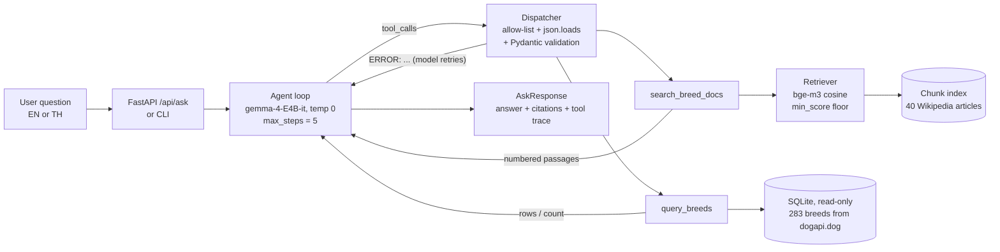

<div align="center">

# 🐕 Dog Breed Advisor

**An LLM agent that helps first-time owners choose and learn about dog breeds — in English or Thai.**

It decides by itself whether a question needs the breed articles (RAG with citations) or the breed database (guarded SQL), answers only from what it finds, and says *"not found"* instead of guessing.


[Highlights](#-highlights) · [How it works](#-how-it-works) · [Quick start](#-quick-start) · [Results](#-results) · [Safety](#-safety) · [Limitations](#-limitations)

</div>

---

## ✨ Highlights

| | |
|---|---|
| 🔀 **Agent picks the tool** | Descriptive questions go to `search_breed_docs`, numeric ones to `query_breeds`, mixed ones to both |
| 📚 **Answers cite sources** | Every fact from the articles carries a `[n]` that links back to the Wikipedia page |
| 🇹🇭 **Thai and English** | Multilingual `bge-m3` finds English articles from Thai questions — BM25 finds none |
| 🛡️ **Safe by construction** | The model never writes SQL; every tool argument is validated with Pydantic; the database is read-only |
| 📏 **Measured, not guessed** | `min_score`, chunk size and retriever were all chosen from evaluation numbers, then checked on a held-out set |

**Example questions**

| Type | Example | Tool used |
|---|---|---|
| Descriptive | *"ชิบะอินุมาจากประเทศอะไร"* · *"Is a Golden Retriever good with children?"* | `search_breed_docs` — RAG over 40 Wikipedia articles |
| Numeric | *"Which 3 breeds are the heaviest?"* · *"How many breeds are in the Toy Group?"* | `query_breeds` — read-only SQL over 283 breeds |
| Both | *"What is a Beagle's temperament, and how heavy is it?"* | both tools |

---

## 🧠 How it works



1. The agent sends the question and two tool definitions to `gemma-4-E4B-it` (temperature 0).
2. When the model asks for a tool, the **dispatcher** checks the tool name against an allow-list, parses the JSON arguments and validates them with Pydantic. Anything invalid goes back to the model as `ERROR: ...` so it can repair its own call.
3. Tool results are wrapped as `TOOL RESULT (untrusted data) <<< … >>>` before the model sees them.
4. The loop ends when the model answers, after `max_steps` turns, or after repeated identical calls — then a final answer is forced with tools disabled.

### Course capability families

| # | Family | Where |
|---|---|---|
| 1 | Structured output + schema validation | `app/schemas/` — Pydantic contracts for every tool argument; invalid calls are returned to the model to repair |
| 2 | Retrieval / RAG with citations | `app/retrieval/` — section-aware chunking (250 words, 15% overlap), bge-m3, cosine search, `min_score` floor, `[n]` citations |
| **3** | **Retrieval evaluation** | `evaluation/` — Recall@k / MRR vs a BM25 baseline, chunk-size and `min_score` sweeps, end-to-end agent eval vs a no-tools baseline on a tuning set and a held-out set |
| **4** | **Agent loop with tools** | `app/services/agent.py` — native tool calling, allow-listed dispatcher, `max_steps`, repeated-call guard, search-first guardrail |
| **5** | **Guarded SQL** | `app/tools/query_breeds.py` — read-only connection, SELECT-only guard, `?` parameter binding, allow-listed sort columns |
| 6 | Served interface | `app/api/` — FastAPI REST endpoint and a web page, deployed on Render |

---

## 🚀 Quick start

> Requires [uv](https://docs.astral.sh/uv/) and access to the class LLM proxy.

**1. Install and configure**

```bash
uv sync
cp .env.example .env        # Windows: copy .env.example .env
```

Fill in `.env` (this file is git-ignored — never commit it):

```
OPENAI_API_KEY=...
OPENAI_BASE_URL=...
```

**2. Check the connection** (chat, embeddings and tool calling)

```bash
uv run python -m scripts.check_connection
```

**3. Build the database and the vector index**

```bash
uv run python -m scripts.build_db        # SQLite from data/raw/dogapi_breeds.json
uv run python -m scripts.build_index     # chunks + bge-m3 embeddings (cached in data/cache/)
```

**4. Run**

```bash
uv run python -m scripts.ask "Which 3 breeds are the heaviest?"     # terminal
uv run uvicorn app.api.main:app --reload                          # web app → http://127.0.0.1:8000
```

<details>
<summary><b>Re-downloading the raw data (optional)</b></summary>

The raw data is already committed in `data/raw/`. To fetch it again, first add
`WIKI_CONTACT=<your email or GitHub URL>` to `.env` — Wikipedia's User-Agent policy requires contact
information, and requests without it are blocked with HTTP 403 — then run:

```bash
uv run python -m scripts.fetch_data      # 40 Wikipedia articles + dogapi.dog breed table
```
</details>

<details>
<summary><b>Deploying on Render</b></summary>

| Setting | Value |
|---|---|
| Language | Python 3 |
| Build command | `uv sync --frozen && uv run python -m scripts.build_db && uv run python -m scripts.build_index` |
| Start command | `uv run uvicorn app.api.main:app --host 0.0.0.0 --port $PORT` |
| Environment | `OPENAI_API_KEY`, `OPENAI_BASE_URL`, and optionally `ACCESS_CODE`, `MAX_ASKS_PER_HOUR` (default 60) |

With `ACCESS_CODE` set, the page must be opened as `https://<app>.onrender.com/?code=<ACCESS_CODE>`,
so a public link cannot use the class proxy key. Free instances sleep after 15 minutes without traffic;
the first request afterwards takes about a minute.
</details>

---

## 📊 Results

All numbers come from `evaluation/results/` and are reproducible with temperature 0.

```bash
uv run python -m evaluation.eval_retrieval                            # retrieval + sweeps
uv run python -m evaluation.eval_agent                                # agent, tuning set
uv run python -m evaluation.eval_agent evaluation/heldout_set.jsonl   # agent, held-out set
uv run pytest                                                         # 43 offline unit tests
```

### Retrieval — dense beats the BM25 baseline

32 labelled questions (22 EN / 10 TH), chunk size 250 words.

| Retriever | Recall@1 | Recall@5 | MRR@10 | Recall@5 EN | Recall@5 TH |
|---|---:|---:|---:|---:|---:|
| BM25 (baseline) | 0.672 | 0.688 | 0.688 | 1.00 | **0.00** |
| **Dense bge-m3 (used)** | **0.922** | **1.000** | **0.956** | 1.00 | **1.00** |
| Hybrid (RRF) | 0.891 | 1.000 | 0.940 | 1.00 | 1.00 |

BM25 finds nothing for Thai questions because Thai words never match the English articles.
Chunk size (100 / 250 / 500 words) made no measurable difference on this document-level metric
(MRR 0.961 / 0.956 / 0.956), so the cheaper 250 was kept.

### `min_score` — the measured improvement over the naive default

32 answerable + 10 unanswerable questions.

| min_score | Answerable kept | Unanswerable rejected |
|---|---:|---:|
| 0.00 — naive default, no floor | 1.00 | 0.00 |
| 0.45 — first guess | 1.00 | 0.70 |
| **0.50 — chosen** | **1.00** | **0.80** |
| 0.55 | 0.91 | 0.90 |

0.55 is marginally higher on balanced accuracy but refuses 3 answerable questions, so 0.50 was kept.
Off-topic questions are all rejected; dog breeds that are *not* in the corpus are only half rejected.

### Agent — vs. the same model without tools

| Test set | Agent | No-tools baseline |
|---|---:|---:|
| Tuning set, v1 (22 questions) | 0.86 | 0.36 |
| Tuning set, v3 after two code fixes | 1.00 | 0.36 |
| **Held-out set (20), automatic check** | **0.55** | **0.20** |
| Held-out set, manual review | 15 ✓ · 2 partial · 3 ✗ | — |

> **The drop from 1.00 to 0.55 is the honest number.** The tuning-set score was optimistic.
> Of the 9 automatic failures on the held-out set, 4 are correct refusals the keyword checker missed,
> 2 are partial answers, and 3 are real errors: a regression caused by the v2 fix, a retrieval miss
> (right article, wrong paragraph) and an ambiguous question.
> See [`heldout_manual_review.md`](evaluation/results/heldout_manual_review.md).

| Test set | Size | Purpose |
|---|---:|---|
| `retrieval_set.jsonl` | 32 | Retrieval metrics; each question labelled with the breed whose article answers it |
| `unanswerable_set.jsonl` | 10 | Off-topic and uncovered-breed questions for the `min_score` sweep |
| `agent_set.jsonl` | 22 | End-to-end agent eval, **used while tuning** |
| `heldout_set.jsonl` | 20 | Written by the project owner **after** tuning, never used to change the system |

SQL gold answers are computed from the database at evaluation time by running a gold filter, so they always match the data.

---

## 🛡️ Safety

| Risk | Protection |
|---|---|
| SQL injection | The model fills a Pydantic form; SQL is built from fixed fragments with `?` binding; sort columns come from an allow-list; SELECT-only guard; database opened `mode=ro` |
| Bad tool calls | Allow-listed tools only; `json.loads` in `try/except`; Pydantic validation; errors fed back to the model instead of crashing |
| Runaway loops | `max_steps = 5`, repeated-call detection, forced final answer with tools disabled |
| Prompt injection in articles | Tool output wrapped as untrusted data; read-only tools mean a fooled model cannot change anything |
| Guessing | `min_score` floor judged on the user's question → `NO_RESULTS` → "not found" |
| Leaked secrets | Key and URL only from environment variables; `.env` is git-ignored |
| Public key abuse | Optional `ACCESS_CODE` and an hourly question budget on the deployed app |
| Proxy errors | Retry with backoff; API maps failures to 429 / 502 / 504 |

---

## 🗂️ Project structure

```
app/
├── core/         config (all settings) · LLM client (the only place that calls the proxy)
├── schemas/      Pydantic contracts: tool arguments, API request/response, chunks
├── retrieval/    chunking · embedding cache · BM25 baseline · dense/hybrid retriever
├── tools/        search_breed_docs · query_breeds (guarded SQL) · allow-listed dispatcher
├── services/     agent loop · shared context
└── api/          FastAPI app + web page
scripts/          check_connection · fetch_data · build_db · build_index · ask
evaluation/       test sets · metrics · eval_retrieval · eval_agent · results/
tests/            offline unit tests with a fake LLM and fake embeddings
data/             wiki_breeds.txt (corpus list) · raw/ (committed source data)
```

---

## ⚠️ Limitations

- **Coverage:** the articles cover 40 breeds and the table 283. General dog-care questions (feeding, training, costs) are outside the corpus, so the agent refuses them where a no-tools model gives an ungrounded answer.
- **Retrieval metric is document-level:** it cannot see when the right article but the wrong paragraph is retrieved.
- **Answer checking is keyword-based:** it misses correctly phrased refusals and cannot judge free-text content, so held-out answers were also reviewed by hand.
- **Small test sets:** a difference of one or two questions may be noise.
- **Data:** weights and life spans are breed averages from one source. Not veterinary advice.

## 📄 Data and licences

- Breed articles — [Wikipedia](https://en.wikipedia.org), CC BY-SA 4.0. Each chunk keeps its source URL, shown as the citation.
- Breed table — [dogapi.dog](https://dogapi.dog), MIT licence.
