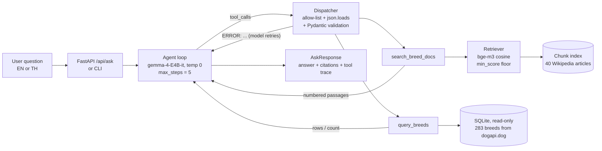

# Dog Breed Advisor

An LLM agent that helps prospective dog owners choose and learn about dog breeds.
It answers two kinds of questions and decides by itself which tool each needs:

| Question type | Example | Tool |
|---|---|---|
| Descriptive | "Is a Shiba Inu good for a first-time owner?" | `search_breed_docs` - RAG over 40 Wikipedia breed articles, answers cite `[n]` |
| Numeric / filtering | "Which hypoallergenic breeds weigh under 4 kg?" | `query_breeds` - guarded read-only SQL over 283 breeds |

Questions can be asked in English or Thai. All LLM calls go through the class proxy
(`from openai import OpenAI`, model `gemma-4-E4B-it`, embeddings `bge-m3`).

## Course capability families covered

| # | Family | Where |
|---|---|---|
| 1 | Structured output + schema validation | `app/schemas/` - every tool argument is parsed and validated with Pydantic; errors are returned to the model so it can repair its call |
| 2 | Retrieval / RAG with citations | `app/retrieval/` - section-aware chunking with 15% overlap, bge-m3 embeddings, cosine search, `min_score` floor, `[n]` citations |
| **3** | **Retrieval evaluation** | `evaluation/` - 32 labelled questions, Recall@k / MRR vs a BM25 baseline, chunk-size and `min_score` sweeps; end-to-end agent eval vs a no-tools baseline on a 22-question tuning set and a 20-question held-out set |
| **4** | **Agent loop with tools** | `app/services/agent.py` - native tool calling, allow-listed dispatcher, `max_steps` stop, repeated-call guard |
| **5** | **Advanced: guarded SQL** | `app/tools/query_breeds.py` - read-only connection, SELECT-only guard, `?` parameter binding, allow-listed sort columns |
| 6 | Served interface | `app/api/` - FastAPI REST endpoint + a small web page |

## Architecture



Error handling: invalid JSON / invalid arguments / unknown tools become `ERROR: ...` tool
results the model can fix; retrieval below `min_score` returns `NO_RESULTS` so the model says
"not found" instead of guessing; the loop stops at `max_steps` or after repeated identical calls
and then forces a final answer with tools disabled. The API maps proxy failures to 429/502/504.

## Setup

Requires [uv](https://docs.astral.sh/uv/).

```bash
uv sync
cp .env.example .env        # Windows: copy .env.example .env
```

Fill in `.env` with your class proxy credentials (never commit this file):

```
OPENAI_API_KEY=...
OPENAI_BASE_URL=...
```

Check the connection (chat, embeddings, tool calling):

```bash
uv run python -m scripts.check_connection
```

## Build the data and index

The raw data is committed in `data/raw/`, so this step is optional. To re-download it from the sources,
first add `WIKI_CONTACT=<your email or GitHub URL>` to `.env` (Wikipedia's User-Agent policy requires contact
information; requests without it are blocked with HTTP 403), then:

```bash
uv run python -m scripts.fetch_data      # Wikipedia articles + dogapi.dog breed table
```

Then build the database and the vector index (embeddings are cached in `data/cache/`):

```bash
uv run python -m scripts.build_db
uv run python -m scripts.build_index
```

## Run

```bash
uv run python -m scripts.ask "Which 3 breeds are the heaviest?"
uv run uvicorn app.api.main:app --reload       # then open http://127.0.0.1:8000
```

## Evaluate

```bash
uv run python -m evaluation.eval_retrieval     # -> evaluation/results/retrieval.md
uv run python -m evaluation.eval_agent         # -> evaluation/results/agent.md
uv run python -m evaluation.eval_agent evaluation/heldout_set.jsonl   # -> agent_heldout_set.md
uv run pytest                                  # offline unit tests, no API key needed
```

All model calls use `temperature=0`. Test sets: `evaluation/retrieval_set.jsonl` (32 answerable),
`evaluation/unanswerable_set.jsonl` (10), `evaluation/agent_set.jsonl` (22, used while tuning),
`evaluation/heldout_set.jsonl` (20, written by the project owner after tuning and never used to change
the system). SQL gold answers are
computed from the database at evaluation time by running a gold filter, so they always match the data.

## Results

Full tables: `evaluation/results/retrieval.md`, `agent.md`, `agent_heldout_set.md`,
and the manual review in `evaluation/results/heldout_manual_review.md`.

**Retrieval** (32 labelled questions, 22 EN / 10 TH, chunk size 250 words)

| Retriever | Recall@1 | Recall@5 | MRR@10 | Recall@5 EN | Recall@5 TH |
|---|---|---|---|---|---|
| BM25 (baseline) | 0.672 | 0.688 | 0.688 | 1.00 | **0.00** |
| Dense bge-m3 (used) | **0.922** | **1.000** | **0.956** | 1.00 | **1.00** |
| Hybrid (RRF) | 0.891 | 1.000 | 0.940 | 1.00 | 1.00 |

BM25 finds nothing for Thai questions because Thai words never match the English articles;
the multilingual embedding model does. Chunk size (100 / 250 / 500 words) made no measurable
difference on this document-level metric (MRR 0.961 / 0.956 / 0.956), so 250 was kept as the cheaper option.

**min_score floor** (32 answerable + 10 unanswerable questions) - the measured improvement over the naive default

| min_score | Answerable kept | Unanswerable rejected |
|---|---|---|
| 0.00 (naive default, no floor) | 1.00 | 0.00 |
| 0.45 (first guess) | 1.00 | 0.70 |
| **0.50 (chosen)** | **1.00** | **0.80** |
| 0.55 | 0.91 | 0.90 |

Off-topic questions are all rejected at 0.50; questions about dog breeds that are *not* in the corpus
are only half rejected, because they are still about dogs.

**End-to-end agent vs. the same model without tools**

| Test set | Agent | No-tools baseline |
|---|---|---|
| Tuning set, v1 (22 questions) | 0.86 | 0.36 |
| Tuning set, v3 after two code fixes | 1.00 | 0.36 |
| **Held-out set (20), automatic check** | **0.55** | **0.20** |
| Held-out set, manual review | 15 correct, 2 partial, 3 wrong | - |

The drop from 1.00 to 0.55 shows the tuning-set score was optimistic. Of the 9 automatic failures on the
held-out set, 4 are correct refusals the keyword checker did not recognise, 2 are partial answers,
and 3 are real errors: a regression caused by the v2 fix (a single-breed lookup rejected for missing a sort
direction), a retrieval miss (the right article, wrong paragraph), and an ambiguous question.

## Project structure

```
app/
  core/        config (all settings), LLM client (the only place that calls the proxy)
  schemas/     Pydantic contracts: tool arguments, API request/response, chunks
  retrieval/   chunking, embedding cache, BM25 baseline, dense/hybrid retriever
  tools/       search_breed_docs, query_breeds (guarded SQL), allow-listed dispatcher
  services/    agent loop, shared context
  api/         FastAPI app + static web page
scripts/       check_connection, fetch_data, build_db, build_index, ask
evaluation/    test sets, metrics, eval_retrieval, eval_agent, results/
tests/         offline unit tests with a fake LLM and fake embeddings
data/          wiki_breeds.txt (corpus list), raw/ (committed source data)
```

## Data and licences

- Breed articles: [Wikipedia](https://en.wikipedia.org), CC BY-SA 4.0. Each stored article keeps its source URL, which the app shows as the citation.
- Breed table: [dogapi.dog](https://dogapi.dog), MIT licence.

## Limitations

- The RAG corpus covers 40 breeds; the SQL table covers 283. A descriptive question about a breed outside the 40 cannot be answered from the documents.
- Weights and life spans are breed averages from one source; real dogs vary.
- The automatic answer check is keyword based: it misses correct refusals phrased differently and cannot judge the content of free-text answers, so held-out answers were also reviewed by hand.
- The retrieval metric is document-level; it cannot see when the right article but the wrong paragraph is retrieved.
- General dog-care questions (feeding, training, costs) are outside the corpus, so the agent refuses them where the no-tools model gives an (ungrounded) answer.
- Not veterinary advice.
